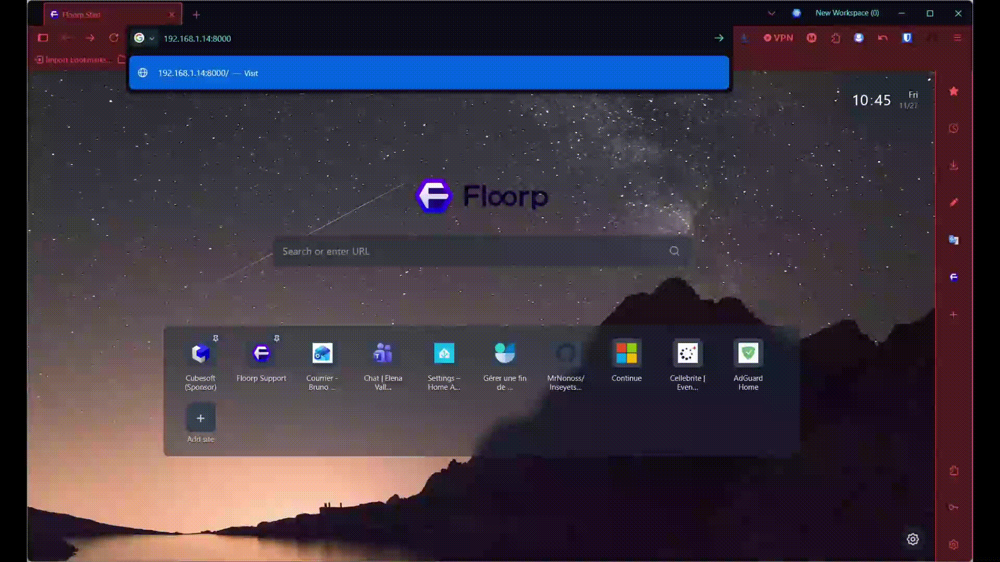

# Torrent Class

A local-network file distribution tool built with Go and BitTorrent. It lets an instructor share large files or folders across a classroom without internet access, a central tracker, or a single-server bottleneck—as students download pieces, they automatically share them with the rest of the room.

Only a proper LAN is required.

## Usage

Grab the binary for your OS from [Releases](https://github.com/MrNonoss/torrent-class/releases).

### Interactive Mode

Double-click the binary (or run it without flags) and follow the prompts. If your machine has multiple network interfaces (e.g., Wi-Fi plus VMware/VirtualBox/VPN adapters), select the one connected to the classroom network.

#### 1. Seeding (Instructor)

Select **Seed**, then choose the file or folder you want to distribute. When seeding starts, the tool also opens a small HTTP server (shown next to `Deploy:` in the terminal, e.g. `http://192.168.1.10:8000`) serving a `shareable_YYYY-MM-DD` folder with a copy of the binary—you can drop small extra files there if students need to grab them from a browser.


#### 2. Downloading (Student)

Select **Download**, pick where to save the files, and let automatic UDP discovery connect to the swarm (or enter the instructor's IP manually if UDP is blocked).



### Command Line

```bash
# Share a file or folder
./torrent-class -m seed -p /path/to/folder

# Download into a folder (auto-discovers the seeder via UDP)
./torrent-class -p /path/to/destination

# Download directly from a known seeder IP (skips UDP discovery)
./torrent-class -p /path/to/destination -s 192.168.1.10
```

| Flag | Default | Description |
| :--- | :--- | :--- |
| `-m`, `--mode` | `download` | `seed` or `download` |
| `-p`, `--path` | `.` | File/folder to seed, or download destination |
| `-s`, `--seeder` | *(auto)* | Seeder IPv4 address (uses HTTP discovery directly) |
| `-i`, `--ip` | *(auto)* | Local IPv4 interface to bind/advertise |
| `-b`, `--bit-port` | `8081` | BitTorrent port |
| `-l`, `--http-port` | `8000` | HTTP server port (used when seeding or fetching `/info`) |
| `-c`, `--max-conns` | `200` | Max peer connections per torrent |

## Network Troubleshooting

- **Same subnet required**: All machines need to be able to reach each other directly on the local network.
- **UDP blocked on corporate/campus Wi-Fi**: Peer discovery uses UDP broadcast (`4243`) first. If no broadcast arrives within 25 seconds, the app prompts for the instructor's IP and fetches the torrent metadata over HTTP (`8000`). You can also skip waiting by choosing **Manual** mode at startup or passing `-s <ip>`.
- **Wrong IP shown in the terminal**: Check `Local IP` at the top of the TUI. If a virtual adapter (Docker, WSL, VMware, VPN) was selected, restart and pick the LAN/Wi-Fi adapter—or pass `-i <your-lan-ip>`.

## Further Reading

- [Technical Overview](docs/TECHNICAL.md)
- [Building from Source](docs/BUILD.md)
